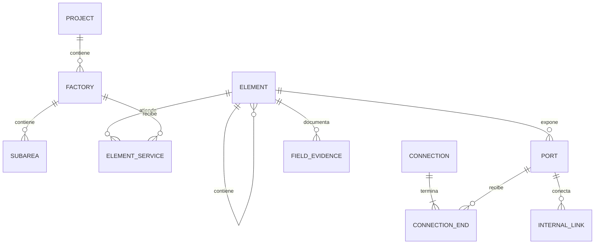

# Modelo propuesto de equipos y conexiones

Estado: diseño para revisión; **no implementado**. Base: `57cf161`.
Fecha: 2026-11-04. Este documento no cambia `schemaVersion=1`.

## 1. Fuente y límites

Se inspeccionó el archivo `ELS-SYC_Excel_General_Tecnico_RevB.xlsx` recibido
en este chat, incluyendo cabeceras y muestras de TABLEROS, ELEMENTOS,
CONDUCTORES, NEUMATICA, DATOS_COMPONENTES y LDM_POR_TABLERO. No se realizó
una validación eléctrica, un recálculo de fórmulas ni una conciliación completa.
Los valores cacheados de Excel pueden diferir de un recálculo reciente.
Textos de las hojas son datos de referencia, no instrucciones para el sistema.

El archivo contiene SEC, EVA, EVB, FM, comunes y registros retirados.
Decisión del usuario: FM es subárea de Secado; TAB-B es un único tablero
que atiende ambos evaporadores. La columna Proyecto de una hoja no basta
para determinar ubicación física ni todos los servicios de un equipo.

Fuentes propuestas para una futura importación:

| Hoja | Uso | Precaución |
|---|---|---|
| ELEMENTOS | Identificación, tipo, referencias a cables | Conciliar TAG y alias; no generar posiciones |
| TABLEROS | Gabinetes y asociaciones | El mismo tablero puede aparecer en ELEMENTOS |
| CARGAS_S1/EA/EB | Datos de potencia y arranque | Distinguir placa, estimación y fórmula |
| CONDUCTORES | Cables identificados por CB | Preservar retirados; no tratarlos como activos |
| NEUMATICA | Válvulas, electroválvulas y tubing | Detectar secciones: no es una única tabla homogénea |
| DATOS_COMPONENTES | Dimensiones y características de catálogo | Conservar fuente y estado por campo |
| LDM_POR_TABLERO | Composición y cantidades | Una cantidad no proporciona posición interna |

Todo ejemplo de las secciones siguientes es **ficticio**, no una asignación
real de cable, TAG, puerto, fabricante o dimensión del Excel.

## 2. Entidades y relaciones



- `Element`: identidad y geometría física, una sola vez por objeto.
- `PhysicalLocation`: fábrica/subárea y descripción física, admitiendo desconocido
  o área común. La posición métrica es independiente de la clasificación.
- `ElementService`: relación muchos a muchos con fábricas atendidas.
- `parentId`: contención física, no alimentación ni mando.
- `Port`: terminal eléctrico o conexión fluídica, con identidad estable.
- `Connection`: cable, manguera o enlace de manifold. No almacenar conexiones
  como textos en una ficha.
- `InternalLink`: continuidad entre puertos de una bornera, paso de gabinete
  o circuito interno; distingue continuidad conductiva de mando funcional.
- `FunctionalRelation`: electroválvula gobierna actuador; actuador acciona
  válvula de proceso. No confundir estas relaciones con contención.
- `RouteAssignment`: recorrido externo de una conexión; futuro grafo de bandejas.
- `FieldEvidence`: procedencia y confirmación por campo.

Secado, Evaporador A y Evaporador B tienen IDs estables y alias de importación
SEC/S1, EVA/EA, EVB/EB. FM tiene `factoryId` de Secado. TAB-B tiene dos
`ElementService`, sin duplicarse; su ubicación se confirma separadamente.
El árbol puede mostrar referencias al mismo ID bajo ambas fábricas; el cómputo
de materiales deduplica por ID. Habrá grupos «Compartidos» y «Sin asignar».

## 3. Contratos TypeScript propuestos

Estos contratos son especificaciones; no se agregan al código de producción.
IDs son cadenas opacas. Las referencias deben pertenecer al mismo proyecto.

```ts
type Id = string;
type Vec3 = { x: number; y: number; z: number };
type Quaternion = { x: number; y: number; z: number; w: number };
type Category =
  | 'electrical_panel' | 'pneumatic_panel' | 'motor' | 'pump' | 'sensor'
  | 'process_valve' | 'solenoid_valve' | 'actuator' | 'luminaire'
  | 'pushbutton' | 'terminal_block' | 'manifold' | 'infrastructure';

type Datum<T> = {
  value: T | null; // null = desconocido; cero conserva su significado físico
  status: 'unknown' | 'estimated' | 'provided' | 'verified' | 'conflict';
  evidenceIds: Id[];
};
type Quantity<U extends string> = { value: number; unit: U };
type PhysicalLocation = {
  kind: 'factory' | 'shared' | 'unassigned';
  factoryId: Id | null;
  subareaId: Id | null;
  description: string | null;
};
type Geometry =
  | { kind: 'box'; widthMm: number; depthMm: number; heightMm: number }
  | { kind: 'cylinder'; diameterMm: number; lengthMm: number }
  | { kind: 'plane'; widthMm: number; depthMm: number }
  | { kind: 'asset'; assetId: Id; boundsMm: Vec3 };

interface ElementBase {
  id: Id;
  tag: string | null; // único en proyecto cuando está informado
  name: string;
  physicalLocation: PhysicalLocation;
  condition: 'existing' | 'new' | 'replacement' | 'unknown';
  lifecycle: 'active' | 'retired';
  parentId: Id | null;
  transform: { positionMm: Vec3; rotation: Quaternion };
  geometry: Geometry | null; // null: dimensiones aún no conocidas
  placementStatus: 'unplaced' | 'placed';
  mounting: 'floor' | 'wall' | 'structure' | 'internal' | 'unknown';
  manufacturer: Datum<string>;
  model: Datum<string>;
  version: number;
}

type TechnicalByCategory = {
  motor: {
    power: Datum<Quantity<'kW' | 'HP'>>;
    voltage: Datum<Quantity<'V'>>;
    phases: Datum<1 | 3>;
    plateCurrent: Datum<Quantity<'A'>>;
    efficiency: Datum<number>; // 0 < η <= 1
    powerFactor: Datum<number>; // 0 < cosφ <= 1
    start: Datum<'direct' | 'star_delta' | 'softstarter' | 'vfd' | 'other'>;
  };
  sensor: {
    measuredVariable: Datum<string>;
    range: Datum<{ min: number; max: number; unit: string }>;
    supply: Datum<{ voltageV: number; currentType: 'AC' | 'DC' }>;
    signal: Datum<'DI' | '4_20mA' | '0_10V' | 'RTD' | 'bus' | 'other'>;
  };
  process_valve: {
    function: Datum<string>;
    nominalSize: Datum<string>; // DN/NPS explícito, no convertir por suposición
    connection: Datum<string>;
    fluid: Datum<string>;
    pressure: Datum<Quantity<'bar'>>;
    temperature: Datum<Quantity<'degC'>>;
  };
  solenoid_valve: {
    configuration: Datum<'2/2' | '3/2' | '5/2' | '5/3' | 'other'>;
    coilSupply: Datum<{ voltageV: number; currentType: 'AC' | 'DC' }>;
    operatingPressure: Datum<{ minBar: number; maxBar: number }>;
    normalState: Datum<string>;
  };
  actuator: {
    technology: Datum<'pneumatic' | 'electric' | 'hydraulic'>;
    action: Datum<'single' | 'double'>;
    motion: Datum<'linear' | 'rotary'>;
    stroke: Datum<Quantity<'mm'>>;
    bore: Datum<Quantity<'mm'>>;
    torque: Datum<Quantity<'Nm'>>;
    workingPressure: Datum<Quantity<'bar'>>;
  };
  electrical_panel: { ipRating: Datum<string>; ratedCurrent: Datum<Quantity<'A'>> };
  pneumatic_panel: { ipRating: Datum<string>; inletPressure: Datum<Quantity<'bar'>> };
  pump: { flow: Datum<Quantity<'m3/h'>>; head: Datum<Quantity<'m'>>; fluid: Datum<string> };
  luminaire: { power: Datum<Quantity<'W'>>; voltage: Datum<Quantity<'V'>>; ipRating: Datum<string> };
  pushbutton: { function: Datum<string>; contacts: Datum<string>; illumination: Datum<boolean> };
  terminal_block: { terminalCount: Datum<number> };
  manifold: { stationCount: Datum<number>; workingPressure: Datum<Quantity<'bar'>> };
  infrastructure: { role: Datum<'floor' | 'building' | 'wall' | 'column' | 'other'> };
};
type Element = {
  [K in Category]: ElementBase & { category: K; technical: TechnicalByCategory[K] }
}[Category];

type Port = {
  id: Id; elementId: Id; name: string;
  localPositionMm: Vec3; localDirection: Vec3;
  anchor: 'fixed_local' | 'face';
} & (
  | { medium: 'electrical'; role: 'power' | 'control' | 'signal' | 'PE';
      terminalName: string; ratedVoltageV: number | null }
  | { medium: 'pneumatic'; role: 'supply' | 'working' | 'exhaust';
      connector: string | null; maxPressureBar: number | null }
);
type Endpoint =
  | { kind: 'port'; portId: Id }
  | { kind: 'unresolved'; sourceLabel: string };
type Connection = {
  id: Id; tag: string | null;
  ends: [Endpoint, Endpoint];
  installationStatus: 'planned' | 'cut' | 'mounted' | 'verified';
  sizingStatus: 'unchecked' | 'pending_data' | 'valid' | 'invalid';
  routeId: Id | null;
} & (
  | { kind: 'cable'; service: 'power' | 'control' | 'instrumentation' | 'maneuver';
      coreCount: Datum<number>; sectionMm2: Datum<number>;
      outerDiameterMm: Datum<number>; minBendRadiusMm: Datum<number> }
  | { kind: 'hose'; innerDiameterMm: Datum<number>; outerDiameterMm: Datum<number>;
      material: Datum<string>; workingPressureBar: Datum<number>;
      minBendRadiusMm: Datum<number> }
  | { kind: 'manifold_passage'; medium: 'pneumatic' }
);
interface FieldEvidence {
  id: Id; elementOrConnectionId: Id; fieldPath: string;
  source: 'manual' | 'xlsx' | 'datasheet' | 'migration';
  fileChecksum: string | null; sheet: string | null; row: number | null;
  cell: string | null; formula: string | null; rawValue: unknown;
  author: string | null; recordedAt: string;
}
```

La ampliación de categorías requiere registrar conjuntamente schema de validación,
ficha, representación y migración; no aceptar bolsas técnicas arbitrarias sin validar.
Los parámetros no aplicables a una tecnología se ocultan y validan condicionalmente.
Un actuador eléctrico no recibe por defecto presión neumática. HP conserva la
unidad original; cualquier conversión debe declarar variante y factor, sin asumir CV.

## 4. Geometría, contención y puertos

Transformaciones locales rígidas, sin escala: `Tglobal(hijo) = Tglobal(padre) × Tlocal(hijo)`.
Para una raíz, la transformación es global. Rotaciones usan quaternion unitario;
posiciones y dimensiones, mm. Z local es el eje longitudinal del cilindro.
El adaptador del visor aplica la conversión de base existente también a orientaciones.
El origen de trabajo sigue siendo una referencia de visualización/entrada, no un padre.

Validar ausencia de ciclos, padre existente y unicidad de contención. El actuador
puede ser hijo físico de una válvula o máquina; su relación funcional se registra
separadamente. Un motor de bomba también puede ser un elemento hijo independiente.

Anclaje inicial al redimensionar: centro de base local para objetos de piso;
centro de cara posterior para gabinete de pared; centro para objetos internos.
Conservar ese punto global recalculando el centro según orientación y dimensiones.
Ofrecer elección explícita de otro anclaje; registrar la operación para deshacer.
La nave conserva centro de base, sin desplazar equipos raíz del interior.

No escalar ni desplazar hijos automáticamente cuando cambia el tamaño del padre.
La compensación del centro del padre debe compensarse en coordenadas locales de
sus hijos para conservar sus transformaciones globales durante el redimensionado.
Mover o rotar deliberadamente el padre sí mueve los hijos.

Puertos fijos conservan posición local, salvo compensación por cambio de centro;
puertos de cara usan cara + coordenadas sobre esa cara y se recalculan con límites.
Si un componente deja de caber, generar incidencia de interferencia. Si se mueve
un puerto, invalidar recorrido/metraje afectado, conservando IDs y asociaciones.
Assets necesitan límites y dimensiones parametrizables; si no admiten deformación,
editar envolvente con aviso, sin afirmar que deforma correctamente el modelo real.
Geometría desconocida se muestra como marcador «sin dimensiones», nunca como una
dimensión real inventada. El piso es plano; volumen y altura positiva no aplican.

## 5. Conectividad y ejemplo completo ficticio

Un cable puede tener varios conductores internos: añadir `CableCore` con extremos
en terminales concretos. El cable físico conserva un único ID y BOM; sus hilos no
se cuentan como cables adicionales. PE y apantallamiento requieren terminales
explícitos. Bornes pasantes usan `InternalLink` para continuidad entre dos puertos.
No unir suministro de aire con escape ni electricidad con neumática. Los puertos
de una electroválvula tienen roles P, A, B, R/S según configuración y fabricante.

El siguiente JSON es una **vista de conectividad**, no un ProjectData importable.
Se omiten transformaciones, Datum y puertos repetidos para facilitar lectura.
Todos los IDs y nombres son ficticios. Cada extremo referencia un puerto que el
proyecto completo deberá declarar y validar.

```json
{
  "exampleOnly": true,
  "elements": [
    {"id":"demo-el", "category":"electrical_panel", "parentId":null},
    {"id":"demo-pn", "category":"pneumatic_panel", "parentId":null},
    {"id":"demo-x", "category":"terminal_block", "parentId":"demo-pn"},
    {"id":"demo-man", "category":"manifold", "parentId":"demo-pn"},
    {"id":"demo-sol", "category":"solenoid_valve", "parentId":"demo-pn"},
    {"id":"demo-pv", "category":"process_valve", "parentId":null},
    {"id":"demo-act", "category":"actuator", "parentId":"demo-pv"}
  ],
  "connections": [
    {"id":"demo-c1", "kind":"cable", "from":"demo-el:control", "to":"demo-x:in"},
    {"id":"demo-c2", "kind":"cable", "from":"demo-x:out", "to":"demo-sol:coil"},
    {"id":"demo-air", "kind":"hose", "from":{"unresolved":"red de aire"}, "to":"demo-man:P"},
    {"id":"demo-pass", "kind":"manifold_passage", "from":"demo-man:station1", "to":"demo-sol:P"},
    {"id":"demo-ha", "kind":"hose", "from":"demo-sol:A", "to":"demo-act:A"},
    {"id":"demo-hb", "kind":"hose", "from":"demo-sol:B", "to":"demo-act:B"}
  ],
  "internalLinks": [{"from":"demo-x:in", "to":"demo-x:out", "kind":"conductive"}],
  "functionalRelations": [
    {"from":"demo-sol", "to":"demo-act", "kind":"controls"},
    {"from":"demo-act", "to":"demo-pv", "kind":"actuates"}
  ]
}
```

El puerto eléctrico `coil` es una interfaz de varios terminales, que en detalle
se descompone en puertos de conductor. R/S deben tener escape/silenciadores según
la ficha elegida; no se omiten de la validación por no aparecer en el ejemplo.
El suministro sin resolver bloquea declaración de instalación completa.
No deducir sección adecuada desde HP: registrar cable asociado y cálculo de
dimensionamiento como estados independientes. Rutas compartidas suman ocupación
de cables y mangueras sin asumir compatibilidad normativa.

Ejemplo de elemento completo conforme al contrato propuesto (también ficticio):

```json
{
  "id": "demo-act",
  "tag": "DEMO-ACT-01",
  "name": "Actuador de ejemplo",
  "category": "actuator",
  "physicalLocation": {
    "kind": "unassigned", "factoryId": null, "subareaId": null,
    "description": null
  },
  "condition": "unknown",
  "lifecycle": "active",
  "parentId": "demo-pv",
  "transform": {
    "positionMm": {"x": 0, "y": 0, "z": 200},
    "rotation": {"x": 0, "y": 0, "z": 0, "w": 1}
  },
  "geometry": {"kind": "cylinder", "diameterMm": 100, "lengthMm": 200},
  "placementStatus": "placed",
  "mounting": "structure",
  "manufacturer": {"value": null, "status": "unknown", "evidenceIds": []},
  "model": {"value": null, "status": "unknown", "evidenceIds": []},
  "version": 1,
  "technical": {
    "technology": {"value": "pneumatic", "status": "provided", "evidenceIds": []},
    "action": {"value": "double", "status": "provided", "evidenceIds": []},
    "motion": {"value": "linear", "status": "provided", "evidenceIds": []},
    "stroke": {"value": null, "status": "unknown", "evidenceIds": []},
    "bore": {"value": null, "status": "unknown", "evidenceIds": []},
    "torque": {"value": null, "status": "unknown", "evidenceIds": []},
    "workingPressure": {"value": null, "status": "unknown", "evidenceIds": []}
  }
}
```

La posición de ejemplo es local a `demo-pv`; las dimensiones son ilustrativas.
En producción los valores informados requieren evidencia y los no aplicables
se identifican por tecnología/movimiento, además de permitir desconocidos.

### Invariantes de validación

- TAG normalizado único por proyecto, con alias históricos separados; no cambiar
  IDs al renombrar. Rechazar referencias cruzadas entre proyectos.
- Subárea debe pertenecer a la fábrica física indicada. En área compartida o
  ubicación desconocida no inventar fábrica. Asociaciones de servicio sin duplicados.
- Dimensiones finitas y positivas salvo espesor inexistente del plano; quaternion
  unitario y dirección de puerto no nula. Un equipo sin ubicar no participa de
  metraje ni se presenta como situado en el origen real.
- Diámetro interior de manguera menor que exterior, radios y presiones positivos;
  tensión, corriente, sección y unidades según el parámetro. Rangos con min <= max.
- Extremos existentes y medio compatible. No unir puertos por proximidad visual.
  Un puerto admite múltiples conexiones solo si su ficha lo permite.
- Los datos conflictivos conservan candidatos y evidencia; no seleccionar
  silenciosamente una fuente. Estimado, proporcionado y verificado son distintos.
- La relación de montaje actuador/válvula no demuestra compatibilidad mecánica.
  Ausencia de datos produce pendiente de validación.

## 6. Ficha y operaciones UI

Ficha común: Identificación; Técnica; Geometría; Conexiones; Componentes;
Procedencia/pendientes. Seleccionar un elemento muestra sus cables y mangueras,
tablero de origen, puertos y relaciones funcionales. Componentes internos se
seleccionan en árbol y mediante vista aislada del gabinete.

Agregar: elegir categoría, ubicación pendiente o confirmada, datos técnicos y
dimensiones conocidas. Aplicar valida antes de mutar. Permitir borrador incompleto
con advertencias; no declararlo instalación verificada. Para sensores y válvulas
no imponer los campos eléctricos de un motor.

Duplicar: nuevos IDs para equipo, hijos y puertos; remapear relaciones internas;
TAG nuevo pendiente de confirmar. No copiar conexiones externas, checklist ni
confirmaciones de campo. Mantener enlace de procedencia de la plantilla y pedir
posición nueva. Catálogo y copia física son conceptos diferentes.

Eliminar: mostrar dependencias y ofrecer cancelar, archivar o eliminación
confirmada del conjunto. No borrar cables/mangueras silenciosamente. Una conexión
con extremo eliminado queda pendiente de resolución y conserva su historial.
Hijos requieren eliminar explícitamente o reubicar conservando posición global.
Archivar es preferible para elementos ya montados. Deshacer una operación debe
restaurar entidades y enlaces coherentemente.

## 7. Migración propuesta desde versión 1

Diseñar `schemaVersion=2` únicamente cuando se implemente y pruebe la migración.
Contendrá `elements`, `factories`, `subareas`, `elementServices`, `ports`,
`connections`, `internalLinks`, `functionalRelations`, `evidence` y `projectOrigin`.
La geometría civil se conserva como categoría infraestructura con rol.

1. Leer y validar v1 sin escribir. Conservar copia íntegra recuperable de v1
   en una transacción de respaldo antes de reemplazar el registro activo.
2. Convertir floor/building a infraestructura con rol; panel a electrical_panel;
   motor a motor. Preservar IDs, nombres, coordenadas y origen exactamente.
3. Quaternion identidad, padre null. Box para edificio/tablero; plane para piso.
   Motor actual: diámetro=width, longitud=height. Si depth difiere de width,
   preservar dimensiones originales en evidencia y marcar conflicto; no descartar.
4. TAG, fábrica, subárea y datos técnicos desconocidos; no asignar los ejemplos
   a una fábrica. Guardar procedencia migration. Nada de fabricar cables/puertos.
5. Validar referencias, invariantes y equivalencia visual; guardar v2 atómicamente.
   Ante error mantener v1 activo y exportable. No hacer downgrade destructivo.
6. Importación acepta v1 mediante migración en memoria; versiones futuras
   desconocidas se rechazan sin modificar el proyecto.

La importación XLSX será un flujo separado: checksum y hoja/fila/celda, detección
de secciones, vista previa de altas/cambios/conflictos y confirmación. Conciliar
TAG entre hojas y CB por ID sin renumerar. Descripciones no son claves únicas.
Conservar decisiones manuales y diferencias entre valor de placa y estimado.

## 8. Entregas pequeñas y criterios de aceptación

| Entrega | Alcance | Verificación requerida |
|---|---|---|
| M1 | Schemas y migración v1→v2, respaldo y recuperación | Round-trip, fallo transaccional, IDs/posiciones intactos |
| M2 | Fábricas/subáreas/asociaciones y árbol | FM dentro de Secado; TAB-B un ID en dos vistas; BOM sin duplicación |
| M3 | Ficha común y alta/edición/archivo | Todos los tipos; desconocidos explícitos; borradores cancelables |
| M4 | Geometría editable y composición | Anclajes, rotaciones, hijos sin escalado, ciclos rechazados |
| M5 | Puertos, conexiones y ficha técnica específica | Cable y manguera diferenciados; bornera intermedia; doble efecto |
| M6 | Simulación XLSX de muestra, sin rutas automáticas | Vista previa, conciliación, procedencia y conflictos sin sobrescritura |
| M7 | Integración con ruteo, BOM y campo | Metraje y ocupación separados de validación eléctrica/neumática |

Antes de M1 revisar este diseño y preparar fixtures v1 reales. Mantener las
pruebas existentes; no incorporar una migración únicamente para completar este
documento. DXF/DWG, PDF, BOM, PWA, soporte de fabricantes y accesorios continúan
en el plan general, con sus requisitos originales.

## 9. Integración de la propuesta remota

Se preservó el trabajo remoto del commit `51bf02d` en
[design-history/51bf02d-equipment-domain-model.md](design-history/51bf02d-equipment-domain-model.md),
junto con sus requisitos y plan históricos. El merge conserva ambos historiales.
Este documento es la especificación propuesta vigente; los archivos históricos
no son contratos alternativos para implementar.

Decisiones revisadas frente a la propuesta inicial:
- Quaternion y una única transformación local/global según padre, evitando dos
  posiciones editables que puedan divergir y permitiendo orientaciones completas.
- Borneras y manifold con identidad propia, continuidad interna explícita.
- Condición y TAG desconocidos al migrar: no asumir existente ni fuente manual.
- Conservar cilindro del motor y respaldo automático antes de migrar.
- Migración antes de incorporar fichas persistidas; no guardar datos v2 en v1.
- Datos por campo y evidencia de Excel disponible en esta sesión.

La propuesta inicial completa permanece consultable para recuperar sus tablas
y ejemplos; no se descartó trabajo remoto ni se realizó force push.
